<div align="center">

  

  # 🕸️ Awesome Multi-Agent Knowledge Graphs

  <p align="center">
    <strong>A curated directory of top-tier Multi-Agent Knowledge Graphs, Enterprise Semantic Ontologies, GraphRAG Retrieval Engines, and Agentic Memory Infrastructures.</strong>
  </p>

  <p align="center">
    <a href="https://github.com/ishandutta2007/Awesome-Awesome-Awesome"></a><a href="https://discord.gg/jc4xtF58Ve"></a>
    <a href="https://github.com/ishandutta2007/Awesome-Multi-Agent-Knowledge-Graphs/stargazers"></a>
    <a href="https://github.com/ishandutta2007/Awesome-Multi-Agent-Knowledge-Graphs/network/members"></a>
    <a href="https://github.com/ishandutta2007/Awesome-Multi-Agent-Knowledge-Graphs/blob/main/LICENSE"></a>
    <a href="https://github.com/ishandutta2007/Awesome-Multi-Agent-Knowledge-Graphs/pulls"></a>
    <a href="https://github.com/ishandutta2007"></a>
  </p>

</div>

---

## 📖 Overview & Architecture Landscape

In autonomous **Multi-Agent Systems (MAS)**, independent AI agents need a shared, structured knowledge substrate to coordinate effectively, communicate facts, and resolve dependencies without hallucinations. **Multi-Agent Knowledge Graphs (MAKG)** provide this critical shared ontology — capturing entities, relationships, temporal observations, and operational constraints in a graph structure that agents can traverse, query, and collaboratively mutate.

Without a governed knowledge graph, multi-agent swarms face severe operational risks: uncoordinated writes cause semantic drift, black-box agent memory leads to untraceable hallucinated states, and vector-only RAG fails to capture deep multi-hop entity relationships. Modern solutions integrate **GraphRAG retrieval**, **Git-style branching for agent mutations**, **six-layer business ontologies**, and **Model Context Protocol (MCP)** tool servers to ensure that multi-agent decision paths remain explainable, auditable, and production-ready.

---

## 📑 Table of Contents

- [🌐 Sector Overview & Market Dynamics](#-sector-overview--market-dynamics)
- [☁️ SaaS & Hosted Platforms](#️-saas--hosted-platforms)
- [🔓 Open-Source GitHub Projects (Ranked by Stars)](#-open-source-github-projects-ranked-by-stars)
- [📊 Architectural Comparison Matrix](#-architectural-comparison-matrix)
- [🤝 How to Contribute](#-how-to-contribute)
- [📈 Star History](#-star-history)
- [💖 Support & Sponsorship](#-support--sponsorship)
- [⚖️ Disclaimer](#️-disclaimer)

---

## 🌐 Sector Overview & Market Dynamics

The global **Knowledge Graph and Graph AI market** was valued at approximately **$2.6 Billion in 2024** and is projected to expand to **$9.4 Billion by 2030** at a Compound Annual Growth Rate (**CAGR of ~23.8%**), driven by surging enterprise demand for structured context, enterprise GraphRAG, and reliable multi-agent reasoning memory.

The sector is currently **moderately fragmented**: enterprise mega-platforms (such as Palantir and Neo4j) anchor high-governance semantic layers and operational ontologies, while high-velocity open-source engines and specialized AI memory startups (e.g., LightRAG, Cognee, Memgraph, FalkorDB) rapidly expand the ecosystem for lightweight, developer-first agent memory and decentralized knowledge graphs.

---

## ☁️ SaaS & Hosted Platforms

The table below lists notable hosted and managed multi-agent knowledge graph platforms, sorted in **descending order by company size** (market capitalization / valuation and annual revenue).

| Platform | Company Size (Valuation / Revenue) | Starting Tier Pricing | Free Tier / Trial Limits | Key Capabilities & Architecture | Primary Agent Sweet Spot |
| :--- | :--- | :--- | :--- | :--- | :--- |
| **[Palantir Foundry / AIP](https://www.palantir.com/)** | **~$95B Market Cap** / ~$2.8B Annual Rev *(Public: NYSE: PLTR)* | **$1,000 / month** *(AWS Marketplace starting base tier for Palantir AIP; Enterprise contracts from $100k/yr)* | **30-Day Free Trial** *(AIP Bootcamp sandbox, up to 1 TB compute credits and full Ontology capabilities)* | Enterprise Ontology contract layer between raw data and AI; bidirectional writeback actions with strict transaction boundaries; granular purpose limitations and audit logs. | Large enterprises requiring a governed semantic ontology where AI agent decisions safely trigger auditable, real-world operational actions. |
| **[Neo4j Context Engine / Aura](https://neo4j.com/)** | **~$2.0B Valuation** / ~$160M+ ARR *(Series F, $325M raised)* | **$65.00 / month** *($0.09/GB-hr for Neo4j AuraDB Professional; AuraDS from $150.00/month)* | **Free Forever** *(1 Aura instance, 200,000 nodes, 400,000 relationships, and 1.25 GB storage)* | Six-layer business ontology spanning processes, domains, data products, systems, tools, and runtime knowledge; GraphRAG retrievers; permanent reasoning memory with decision tracking logs. | Production multi-agent fleets requiring an explainable, enterprise-governed knowledge layer and permanent decision audit trails. |
| **[TigerGraph Cloud](https://tigergraph.com/)** | **~$1.0B Valuation** / ~$60M Estimated Rev *(Series C, $105M raised)* | **$0.24 / hour** *(~$175 / month for tg.s4.2 cloud instance with dedicated compute & memory)* | **Free Forever** *(1 free tier cloud instance, 8 GB RAM, 50 GB storage, up to 10M edges)* | Enterprise graph engine with dedicated Agentic AI stack; native MCP Server exposes graph capabilities as tools; hybrid vector + graph traversal; real-time parallel graph processing. | High-throughput enterprise workloads requiring real-time parallel graph traversal at scale for multi-agent coordination. |
| **[Memgraph Cloud](https://memgraph.com/)** | **~$50M Valuation** / ~$8M Estimated ARR *(Series A, $12.3M raised)* | **$84.00 / month** *(Cloud Starter: 2 GB RAM, 1 vCPU, 20 GB disk storage)* | **14-Day Free Trial** *(8 GB RAM instance, unconstrained Cypher queries, no credit card required)* | In-memory Cypher-compatible C++ graph engine; streaming graph algorithms; native vector search integration for GraphRAG; sub-millisecond multi-agent memory retrieval. | Real-time streaming agent workflows, dynamic multi-agent conversational state, and low-latency GraphRAG retrieval. |
| **[FalkorDB Cloud](https://www.falkordb.com/)** | **~$35M Valuation** / ~$3M Estimated ARR *(Seed, $6M+ raised)* | **$19.00 / month** *(Starter Cluster: 2 GB RAM, 5 GB storage; serverless pay-per-query from $0.15/10k queries)* | **Free Forever** *(1 database instance, 250 MB data storage, up to 100,000 queries per month)* | GraphBLAS sparse linear algebra engine; Cypher query language; tailored GraphRAG retrievers designed for LLM agent workflows and low-latency knowledge graphs. | Developers requiring fast GraphRAG pipelines and lightweight LLM agent memory with ultra-low query latency. |
| **[Zep Cloud](https://www.getzep.com/)** | **~$25M Valuation** / ~$2M Estimated ARR *(Seed, $4.5M raised)* | **$49.00 / month** *(Developer Tier: up to 20,000 messages/month, $0.0025 per additional message)* | **Free Forever** *(Up to 1,000 agent sessions / 2,500 messages per month, graph memory persistence)* | Temporal knowledge graphs for agent memory; auto-extracts facts, user intent, and entity relationships; integrates seamlessly with LangChain, LlamaIndex, and MCP. | Multi-turn agent memory, personalization, and long-term conversation history for autonomous AI assistants. |

---

## 🔓 Open-Source GitHub Projects (Ranked by Stars)

The following open-source frameworks provide self-hosted, customizable, and inspectable knowledge graph infrastructure for multi-agent systems and GraphRAG. Projects are **ranked in descending order by GitHub stargazers count**.

### 1. [LightRAG](https://github.com/HKUDS/LightRAG) [](https://github.com/HKUDS/LightRAG/stargazers)
- **Repository**: [`HKUDS/LightRAG`](https://github.com/HKUDS/LightRAG)
- **Primary Focus**: Dual-level graph-based Retrieval-Augmented Generation (low-level specific entity retrieval + high-level thematic concept retrieval).
- **Key Features**: Fast graph indexing, dual-level retrieval architecture, multi-agent knowledge integration, significantly lower LLM token consumption compared to standard GraphRAG, seamless integration with local LLMs and vector stores.
- **Agent Application**: Provides multi-agent teams with shared high-level topic understanding and fine-grained entity reasoning without exorbitant token overhead.

### 2. [GraphRAG](https://github.com/microsoft/graphrag) [](https://github.com/microsoft/graphrag/stargazers)
- **Repository**: [`microsoft/graphrag`](https://github.com/microsoft/graphrag)
- **Primary Focus**: Modular graph-based Retrieval-Augmented Generation pipeline using LLM-extracted knowledge graphs and hierarchical community summaries.
- **Key Features**: Hierarchical community detection using the Leiden algorithm, automated extractive knowledge graph construction, global search across community summaries, local search for entity neighborhoods.
- **Agent Application**: Ideal as a macro-knowledge retrieval engine where agents must reason across complex unstructured corpora with high semantic fidelity.

### 3. [Cognee](https://github.com/topoteretes/cognee) [](https://github.com/topoteretes/cognee/stargazers)
- **Repository**: [`topoteretes/cognee`](https://github.com/topoteretes/cognee)
- **Primary Focus**: AI memory platform for autonomous agents that structures unstructured data into customizable knowledge graphs and vector indexes.
- **Key Features**: Graph-structured memory pipelines, ECL (Extract, Cognify, Load) architecture, multi-engine support (Neo4j, NetworkX, Qdrant, LanceDB), automatic entity linking and deduplication.
- **Agent Application**: Serves as persistent, long-term multi-agent memory, enabling agents to remember user preferences, team facts, and operational history across sessions.

### 4. [Dgraph](https://github.com/dgraph-io/dgraph) [](https://github.com/dgraph-io/dgraph/stargazers)
- **Repository**: [`dgraph-io/dgraph`](https://github.com/dgraph-io/dgraph)
- **Primary Focus**: High-performance, horizontally distributed native GraphQL/GraphQL+- graph database written in Go.
- **Key Features**: Synchronous replication via Raft consensus, distributed ACID transactions, native GraphQL engine, highly scalable sharded storage.
- **Agent Application**: Production backbone for large-scale multi-agent coordination requiring high-throughput concurrent writes, ACID guarantees, and distributed multi-tenant storage.

### 5. [Neo4j Community](https://github.com/neo4j/neo4j) [](https://github.com/neo4j/neo4j/stargazers)
- **Repository**: [`neo4j/neo4j`](https://github.com/neo4j/neo4j)
- **Primary Focus**: The foundational open-source labeled property graph database core.
- **Key Features**: Cypher declarative query language, native graph storage and indexing engine, extensive ecosystem integrations (LangChain, LlamaIndex, APOC procedures).
- **Agent Application**: Reliable, battle-tested knowledge graph engine for custom multi-agent memory implementations, entity relationship queries, and GraphRAG pipelines.

### 6. [NebulaGraph](https://github.com/vesoft-inc/nebula) [](https://github.com/vesoft-inc/nebula/stargazers)
- **Repository**: [`vesoft-inc/nebula`](https://github.com/vesoft-inc/nebula)
- **Primary Focus**: Distributed, ultra-high-throughput open-source graph database built for massive graphs with billions of vertices and trillions of edges.
- **Key Features**: Disaggregated compute-storage architecture, openCypher-compatible nGQL query language, horizontal auto-scaling, Raft-based storage engines.
- **Agent Application**: Massive multi-agent enterprise deployments where swarms of agents generate and analyze enormous knowledge graphs simultaneously.

### 7. [FalkorDB](https://github.com/FalkorDB/FalkorDB) [](https://github.com/FalkorDB/FalkorDB/stargazers)
- **Repository**: [`FalkorDB/FalkorDB`](https://github.com/FalkorDB/FalkorDB)
- **Primary Focus**: Ultra-fast graph database leveraging GraphBLAS sparse matrix linear algebra for low-latency GraphRAG and AI agent memory.
- **Key Features**: Sparse adjacency matrix graph representation, native openCypher support, embedded vector indexing, extreme sub-millisecond query execution.
- **Agent Application**: High-frequency multi-agent loops and agentic workflows where graph lookups and updates must execute in single-digit milliseconds.

### 8. [Zep Community Engine](https://github.com/getzep/zep) [](https://github.com/getzep/zep/stargazers)
- **Repository**: [`getzep/zep`](https://github.com/getzep/zep)
- **Primary Focus**: Long-term memory engine for AI assistants and autonomous agent workflows.
- **Key Features**: Temporal graph extraction, entity resolution, summarization pipelines, vector semantic search over historical dialog, SDKs for Python and TypeScript.
- **Agent Application**: Shared conversational memory for customer support agents, personal AI assistants, and cooperative multi-agent task runners.

### 9. [Apache AGE](https://github.com/apache/age) [](https://github.com/apache/age/stargazers)
- **Repository**: [`apache/age`](https://github.com/apache/age)
- **Primary Focus**: PostgreSQL extension that introduces multi-model graph database functionality inside standard relational Postgres databases.
- **Key Features**: openCypher support over relational Postgres tables, hybrid SQL + Cypher queries, ACID transactions, full access to Postgres extensions (e.g., `pgvector`).
- **Agent Application**: Teams wanting to add multi-agent knowledge graph traversal directly into existing PostgreSQL infrastructure without introducing new database engines.

### 10. [Memgraph](https://github.com/memgraph/memgraph) [](https://github.com/memgraph/memgraph/stargazers)
- **Repository**: [`memgraph/memgraph`](https://github.com/memgraph/memgraph)
- **Primary Focus**: High-performance in-memory graph database engineered in C++ for real-time analytics, GraphRAG, and agentic AI memory.
- **Key Features**: Cypher query language compliance, built-in vector similarity search, dynamic graph algorithms (MAGE library), Kafka and Pulsar native stream ingestion.
- **Agent Application**: Real-time multi-agent communication hubs, live event correlation, and instant fact synchronization across distributed agent fleets.

### 11. [Fast-GraphRAG](https://github.com/circlemind-ai/fast-graphrag) [](https://github.com/circlemind-ai/fast-graphrag/stargazers)
- **Repository**: [`circlemind-ai/fast-graphrag`](https://github.com/circlemind-ai/fast-graphrag)
- **Primary Focus**: Intelligent, interpretable, and cost-efficient GraphRAG system that automatically adapts to specific use cases and queries.
- **Key Features**: Asynchronous indexing, dynamic graph exploration, PageRank-based entity importance ranking, automated entity resolution, plug-and-play LLM support.
- **Agent Application**: Rapid retrieval augmentation for autonomous agents needing targeted, explainable sub-graphs for context-grounded reasoning.

### 12. [Omnigraph](https://github.com/ModernRelay/omnigraph) [](https://github.com/ModernRelay/omnigraph/stargazers)
- **Repository**: [`ModernRelay/omnigraph`](https://github.com/ModernRelay/omnigraph)
- **Primary Focus**: Object-storage-native knowledge graph engine built in Rust on Apache Arrow, DataFusion, and Lance, featuring Git-style branching for agent collaboration.
- **Key Features**: Git-style branches, commits, merges, and transactional runs for agent-generated mutations; typed schema-as-code and query linting; native blob-as-data support; S3-native storage with snapshot-pinned reads; Cedar policy-as-code for server-side access control.
- **Agent Application**: Multi-agent environments where agents propose knowledge graph modifications on isolated branches, enabling human review and merge governance before updates affect global state.

### 13. [TrikeDB](https://github.com/RyutoYoda/trikedb) [](https://github.com/RyutoYoda/trikedb)
- **Repository**: [`RyutoYoda/trikedb`](https://github.com/RyutoYoda/trikedb)
- **Primary Focus**: Lightweight, single-file knowledge graph that stores the complete graph state in a human-readable YAML document.
- **Key Features**: Full SPARQL 1.1 support via Oxigraph, SHACL validation, RDFS/OWL inference, native Model Context Protocol (MCP) server with OAuth 2.1 authentication, 11 built-in MCP agent tools, automated provenance tracking.
- **Agent Application**: Single-file, zero-database agent environments where agents query, validate, and update knowledge over standardized MCP tools with RDF/SHACL guardrails.

### 14. [DocsIQ](https://github.com/rhkiswani/docsiq) [](https://github.com/rhkiswani/docsiq)
- **Repository**: [`rhkiswani/docsiq`](https://github.com/rhkiswani/docsiq)
- **Primary Focus**: Single-binary GraphRAG knowledge base and local documentation search engine written in Go.
- **Key Features**: Pure-Go Louvain community detection, entity extraction pipeline, persistent wikilinked markdown notes, embedded React SPA, SQLite with FTS5 and `sqlite-vec`, full Model Context Protocol (MCP) server.
- **Agent Application**: Standalone edge agents and local multi-agent setups requiring zero-dependency graph retrieval and document search over MCP.

---

## 📊 Architectural Comparison Matrix

| Project | Primary Model | Consensus / Storage Engine | Query Language / Interface | Agent Collaboration Paradigm | Governance & Validation | Primary Sweet Spot |
| :--- | :--- | :--- | :--- | :--- | :--- | :--- |
| **LightRAG** | Dual-Level Graph + Vector | Hybrid (NetworkX / Neo4j / NanoVectorDB) | Python SDK / REST API | Dual-level hierarchical concept & entity retrieval | Token-optimized community aggregation | Cost-effective GraphRAG for multi-agent reasoning |
| **GraphRAG** | Hierarchical Graph Communities | Document/Parquet Datasets | CLI / Python Pipelines | Leiden community summaries + entity graphs | Automated entity clustering & global synthesis | Macro-corpus reasoning across massive unstructured data |
| **Cognee** | Multi-Layer Graph Memory | Multi-Engine (Neo4j / LanceDB / Qdrant) | Python API / Pipelines | Persistent agent memory & entity linking | ECL validation pipelines | Persistent long-term memory for multi-agent teams |
| **Dgraph** | Native Distributed Graph | Raft Consensus + Badger KV | GraphQL / GraphQL+- | Multi-tenant distributed agent coordination | ACID distributed transaction boundaries | Scalable, high-throughput distributed graph operations |
| **Neo4j** | Labeled Property Graph | Native Graph Storage / Disk | Cypher / APOC / Driver APIs | Centralized shared graph database | ACID transactions & Enterprise RBAC | Core graph foundation for enterprise agent memory |
| **NebulaGraph** | Distributed Property Graph | Shared-Nothing Raft KV | nGQL (openCypher compatible) | Massive horizontal swarm agent access | Distributed schema validation & isolation | Billions of nodes/edges for hyperscale agent swarms |
| **FalkorDB** | Sparse Linear Algebra Graph | GraphBLAS + Redis/Embedded | openCypher + Vector Search | Ultra-low latency memory retrieval | Strict Cypher typing & fast index constraints | Sub-millisecond GraphRAG retrieval in agent loops |
| **Zep** | Temporal Knowledge Graph | PostgreSQL + pgvector | REST API / Python / TS SDKs | Shared session and agent persona memory | Temporal fact validity & entity resolution | Conversational agent memory and dialogue history |
| **Apache AGE** | Relational Property Graph | PostgreSQL Storage Core | openCypher + SQL | Hybrid relational + graph agent queries | ACID transactions & Postgres RBAC | Adding graph memory into existing Postgres setups |
| **Memgraph** | In-Memory Graph Core | In-Memory C++ Engine | Cypher + Vector Similarity | Real-time streaming agent communication | ACID compliance & stream transaction checks | High-speed real-time event streaming and graph memory |
| **Omnigraph** | Object-Storage Native Graph | Arrow + DataFusion + S3 | Typed Schema & Query DSL | Git-style branches, commits & merges | Cedar policy-as-code & PR-style reviews | Auditable, branch-based collaborative agent edits |
| **TrikeDB** | Single-File RDF/YAML | YAML File + Oxigraph Core | SPARQL 1.1 + MCP Tools | Single-file MCP tool-based agent interaction | SHACL validation & ontology error guardrails | Lightweight, zero-server agent memory over MCP |
| **DocsIQ** | Single-Binary GraphRAG | SQLite (FTS5 + sqlite-vec) | REST / React SPA / MCP | Local tool access via Model Context Protocol | Louvain community validation | Zero-dependency local documentation graph search |

---

## 🤝 How to Contribute

Contributions, project suggestions, and documentation enhancements are highly encouraged!

1. **Fork the repository** to your own GitHub account.
2. **Create a descriptive feature branch**:
   ```bash
   git checkout -b feat/add-graph-tool
   ```
3. **Commit your modifications** ensuring clear, factual descriptions, links to official documentation, and consistent Markdown table formatting.
4. **Push the branch** and **open a Pull Request** with an informative summary of your changes.

---

## 📈 Star History

[](https://star-history.dera.page/#ishandutta2007/Awesome-Multi-Agent-Knowledge-Graphs&type=date&legend=top-left)

---

## 💖 Support & Sponsorship

If you find this curated Multi-Agent Knowledge Graphs directory helpful for your AI architectures, research, or production workflows, please consider supporting the project:

- ⭐ **Star this repository** on GitHub to help others discover it!
- 🍴 **Fork the repository** to contribute updates, new frameworks, or research papers.
- 📢 **Share** with fellow AI engineers, multi-agent system developers, and graph researchers.
- ☕ **Support continuous maintenance & updates** by sponsoring via GitHub Sponsors:

<p align="center">
  <a href="https://github.com/sponsors/ishandutta2007">
    
  </a>
</p>

---

## ⚖️ Disclaimer

- This repository is a **community-curated directory** created strictly for educational, architectural, and informational purposes. Mention of specific open-source libraries, cloud vendors, or proprietary platforms does not imply official endorsement.
- **Multi-Agent Knowledge Graph Governance**: Permitting autonomous AI agents to mutate shared knowledge graphs without review controls can cause catastrophic hallucination cascades and semantic degradation. Platforms providing branching (e.g., Omnigraph) or semantic contract layers with action validation (e.g., Palantir AIP, Neo4j Context Engine) mitigate these risks through auditable transaction logs and human-in-the-loop merge controls.
- **GraphRAG Trade-Offs**: While GraphRAG offers superior multi-hop reasoning over vanilla vector RAG, entity extraction and community summarization involve significant LLM compute during graph construction. Evaluate indexing throughput, graph update frequencies, and inference latency requirements before selecting an engine.
- Always validate graph database benchmarks, memory footprints, and security policies within staging environments prior to production rollout.

---

<p align="center">
  <strong>Crafted with ❤️ for AI engineers, multi-agent architects, and knowledge graph researchers building the next generation of explainable autonomous intelligence.</strong>
</p>
